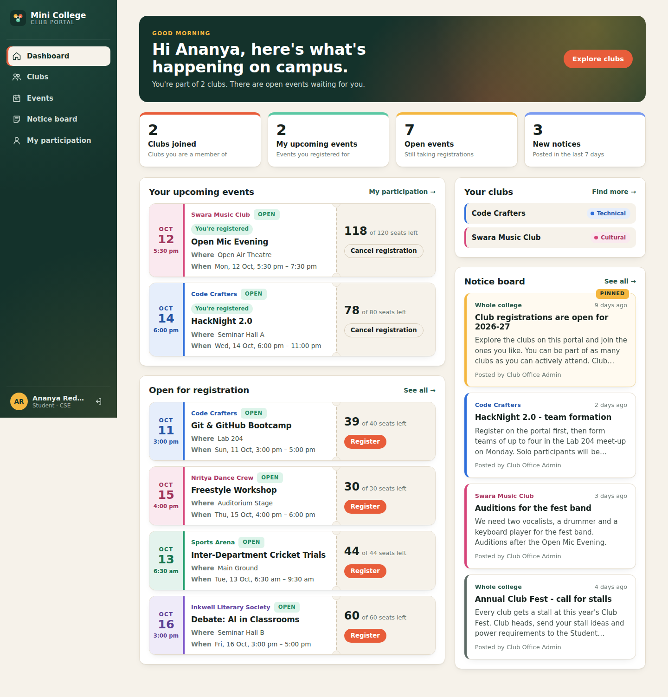
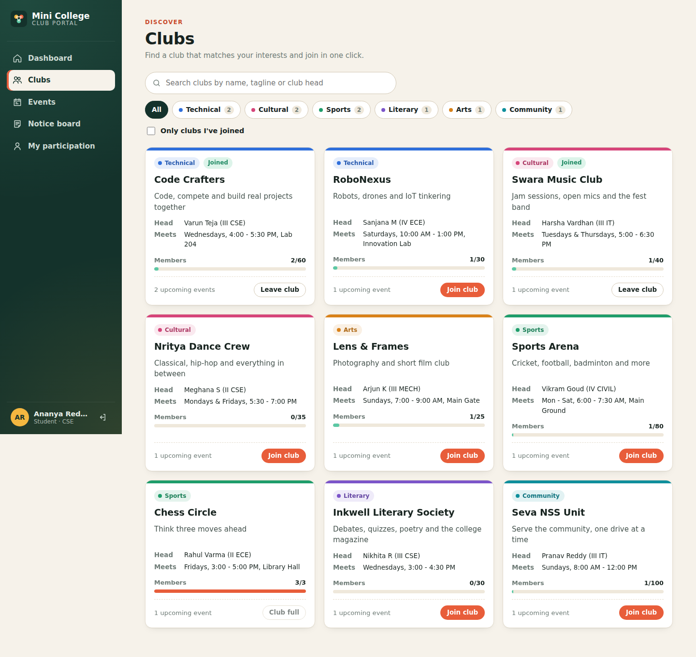
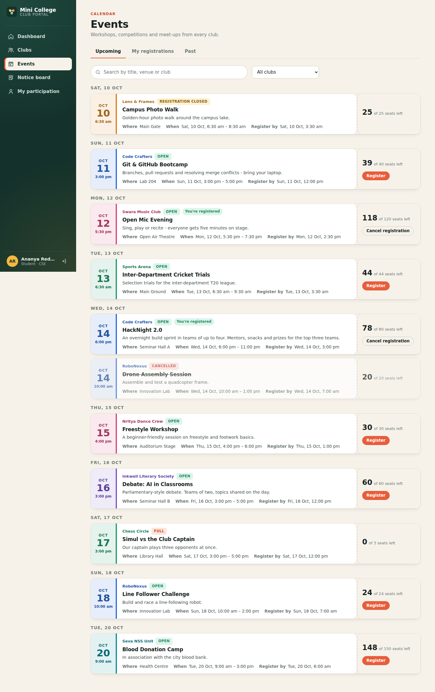
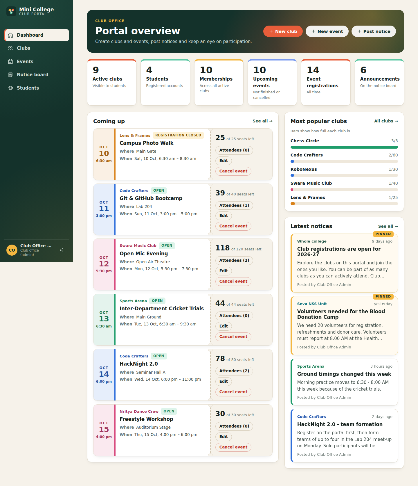

# Mini College Club Portal

A web portal that puts every college club, event, registration and announcement in one place.
Students explore clubs, join them, register for events and read the notice board. The club office (admin)
creates clubs and events, posts announcements and tracks participation.

**Stack:** React + CSS (frontend) · Spring Boot + MySQL (backend) · Docker



---

## Features

**Students**
- Sign up and log in (passwords are hashed, sessions use JWT tokens)
- Explore clubs with **search** and **category filters** (Technical, Cultural, Sports, Literary, Arts, Community)
- **Join or leave** a club in one click. Clubs have a member limit, so a full club can't take new members
- See **upcoming events** grouped by date, filter by club, and **register or cancel** a registration
- Seats are limited. Registration closes at the deadline, and cancelled events can't be booked
- **Notice board** with pinned notices first. "For me" shows college-wide notices plus notices from my clubs
- **My participation** page: my clubs, upcoming registrations and event history

**Admin (club office)**
- Dashboard with live statistics, the most popular clubs and upcoming events
- Create, edit, **archive and restore** clubs
- Create, edit and **cancel** events, and view the attendee list (download as CSV)
- View club members and remove a member
- Post, edit, pin and delete announcements for one club or the whole college
- List of all students with how many clubs and events each one has joined

**Quality**
- Every input is validated twice: in the browser and on the server
- One clean error format on every endpoint: `{ "error": "EVENT_FULL", "message": "Sorry, all seats for this event are taken." }`
- Row locks (`SELECT ... FOR UPDATE`) so two students can't take the last seat at the same time
- 15 automated API tests (JUnit + MockMvc)

| Club list | Events | Admin dashboard |
|---|---|---|
|  |  |  |

---

## Tech stack

| Layer | Technology |
|---|---|
| Frontend | React 19, React Router 7, Axios, plain CSS, Vite |
| Backend | Java 17, Spring Boot 3.3, Spring Web, Spring Data JPA (Hibernate), Spring Security, JWT (jjwt), Bean Validation |
| Database | MySQL 8 (H2 in-memory for tests and quick runs) |
| Testing | JUnit 5, Spring MockMvc |
| DevOps | Docker, Docker Compose, nginx |

---

## Project structure

```
mini-college-club-portal/
├── backend/                     Spring Boot REST API
│   └── src/main/java/com/miniclub/
│       ├── config/              Security config, demo data seeder
│       ├── controller/          REST endpoints
│       ├── dto/                 Request / response objects
│       ├── exception/           Global error handling
│       ├── model/               JPA entities (User, Club, ClubMember, Event, EventRegistration, Announcement)
│       ├── repository/          Spring Data repositories
│       ├── security/            JWT creation and the request filter
│       └── service/             Business rules
├── frontend/                    React app
│   └── src/
│       ├── api/                 Axios client and API calls
│       ├── components/          Cards, tickets, modals, forms
│       ├── context/             Login state, toasts
│       ├── pages/               Dashboard, Clubs, Club detail, Events, Notice board, My participation, Students
│       ├── styles/              CSS
│       └── utils/               Formatting, validation, data loading
├── database/schema.sql          MySQL tables (created automatically, kept for reference)
└── docker-compose.yml           MySQL + backend + frontend in one command
```

---

## Run with Docker (easiest)

Needs only [Docker Desktop](https://www.docker.com/products/docker-desktop/).

```bash
cp .env.example .env              # Windows PowerShell: copy .env.example .env
docker compose up -d --build      # first build takes a few minutes
```

Open **http://localhost:3000**. Check the API at http://localhost:8080/api/health.

Stop it with `docker compose down`. Your data stays in the `db-data` volume.

### Docker Hub images

| Image | Link |
|---|---|
| Backend | https://hub.docker.com/r/YOUR_DOCKERHUB_USERNAME/mini-club-portal-backend |
| Frontend | https://hub.docker.com/r/YOUR_DOCKERHUB_USERNAME/mini-club-portal-frontend |

To run the published images without building, put `DOCKERHUB_USER=YOUR_DOCKERHUB_USERNAME` in `.env`, then run:

```bash
docker compose pull backend frontend
docker compose up -d --no-build
```

**How it fits together:** the browser talks to nginx on port 3000. nginx serves the React app and forwards `/api/*`
to the Spring Boot container, which stores everything in the MySQL container.

---

## Run without Docker

**Needs:** Java 17+, Maven, Node.js 20+ (MySQL 8 is optional).

**1. Backend**, in the `backend` folder:

```bash
# Option A - no MySQL needed (data is kept in memory and reset on restart)
mvn spring-boot:run "-Dspring-boot.run.profiles=h2"

# Option B - with MySQL (the database is created automatically)
# Windows PowerShell: $env:DB_PASSWORD="your-mysql-password"
export DB_PASSWORD=your-mysql-password
mvn spring-boot:run
```

The API runs on http://localhost:8080.

**2. Frontend**, in the `frontend` folder:

```bash
npm install
npm run dev
```

Open **http://localhost:5173**. Vite forwards `/api` calls to the backend.

**Run the tests:** `mvn test` in the `backend` folder.

---

## Demo accounts

The backend fills an empty database with 9 clubs, 13 events and 6 notices.

| Role | Email | Password |
|---|---|---|
| Admin | admin@clubportal.edu | Admin@123 |
| Student | student@clubportal.edu | Student@123 |
| Student | rahul@clubportal.edu | Student@123 |
| Student | fatima@clubportal.edu | Student@123 |
| Student | karthik@clubportal.edu | Student@123 |

The demo data shows every rule: **Chess Circle** is full, "Simul vs the Club Captain" has no seats left,
"Campus Photo Walk" registration is closed, and "Drone Assembly Session" is cancelled.

---

## Configuration

| Variable | Default | Purpose |
|---|---|---|
| `DB_URL` | `jdbc:mysql://localhost:3306/mini_club_portal?...` | MySQL connection |
| `DB_USERNAME` / `DB_PASSWORD` | `root` / `root` | MySQL login |
| `JWT_SECRET` | dev value | Token signing key, 32+ characters. **Change it in production** |
| `CORS_ORIGINS` | `http://localhost:5173,...:3000` | Browser origins allowed to call the API |

---

## API overview

All endpoints are under `/api`. Every one except login, sign-up and health needs `Authorization: Bearer <token>`.

| Method | Endpoint | Who | What |
|---|---|---|---|
| POST | `/auth/register` | public | Create a student account |
| POST | `/auth/login` | public | Log in, returns a token |
| GET | `/auth/me` | any | Current user |
| GET | `/clubs?search=&category=` | any | List clubs |
| GET | `/clubs/{id}` | any | Club details, upcoming events, club notices |
| POST / PUT | `/clubs`, `/clubs/{id}` | admin | Create / edit a club |
| PATCH | `/clubs/{id}/active` | admin | Archive or restore |
| POST / DELETE | `/clubs/{id}/join` | student | Join / leave |
| GET | `/clubs/{id}/members` | admin | Member list |
| DELETE | `/clubs/{id}/members/{userId}` | admin | Remove a member |
| GET | `/events?when=upcoming\|past&clubId=&mine=` | any | List events |
| POST / PUT | `/events`, `/events/{id}` | admin | Create / edit an event |
| POST | `/events/{id}/cancel` | admin | Cancel an event |
| POST / DELETE | `/events/{id}/register` | student | Register / cancel registration |
| GET | `/events/{id}/attendees` | admin | Attendee list |
| GET | `/announcements?clubId=&mine=` | any | Notice board |
| POST / PUT / DELETE | `/announcements`, `/announcements/{id}` | admin | Manage notices |
| GET | `/dashboard` | any | Role-based dashboard |
| GET | `/me/activity` | student | My clubs and registrations |
| GET | `/students` | admin | All students with activity counts |

---

## Future scope

- Audition registration for clubs that select members
- Attendance tracking at events
- Email and push notifications
- Digital participation certificates
- Analytics charts for club activity
